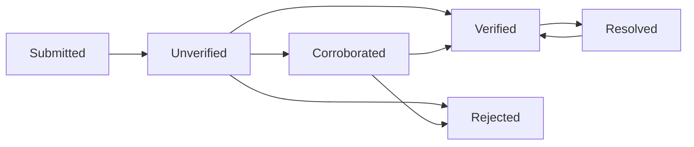

# School Walking & Biking Safety — Project Logistics

> **Status:** Planning / prototype  
> **Target:** Congressional App Challenge 2026  
> **Initial geography:** One school and its surrounding public walking/biking network in the Schaumburg area  
> **Team:** Two student developers  
> **Document owner:** Project team  
> **Last updated:** October 17, 2026

## 1. Project purpose

Build a web app that helps communities **document pedestrian and bicycle infrastructure concerns near schools**, **see patterns on a map**, **prioritize places for review**, and **compare route options using known infrastructure data**.

The app is a **planning and awareness prototype**. It does **not** certify routes as safe, replace official hazard reporting, or instruct users to cross where it is illegal or unsafe.

### Core user stories

- **Parent / student:** I can see reported obstacles near a selected school without sharing my home address.
- **Community member:** I can submit a report about a sidewalk, crossing, or bike route and see whether it is under review.
- **School / local planner:** I can see a ranked set of concerns, supporting evidence, and why each concern received its score.
- **Route viewer:** I can compare permitted, mapped route alternatives and understand their data limitations.

## 2. Scope: what we will and will not build

### Minimum viable product (MVP) — must finish

- [ ] Display **one** school-area map with relevant infrastructure layers.
- [ ] Show example or verified hazard pins with category, severity, date, and status.
- [ ] Let a user submit a hazard: map location, category, description, optional photo, optional severity suggestion.
- [ ] Store submissions in a database; default public status is **unverified**.
- [ ] Detect probable duplicate reports based on location, category, and time window; queue for review rather than silently merging.
- [ ] Let a reviewer mark reports **corroborated**, **verified**, **resolved**, or **rejected** with an explanation.
- [ ] Rank *verified/corroborated* hazards using a transparent, documented scoring method; display unverified reports separately.
- [ ] Show each priority score's component values and explanation.
- [ ] Make the prototype usable on desktop and mobile.
- [ ] Provide a sample dataset clearly labeled **synthetic/demo**, if authentic reports are unavailable.

### Stretch goal — only after MVP works

- [ ] Compare at least two **walking** routes using a checked network of sidewalks and designated crossings.
- [ ] Show distance, reported/verified hazard exposure, and known data gaps for each route.
- [ ] Add **biking** mode only after verifying bicycle-permitted paths and bicycle-specific restrictions.
- [ ] Model how repairing one verified problem changes route scores or affected route counts.

### Explicitly out of scope for the competition prototype

- Real-time tracking of children or families.
- Collecting home addresses or personal school schedules.
- Automatically declaring routes "safe" or "unsafe."
- Automatic dispatch to 911, schools, or local government.
- Citywide coverage before the pilot area is checked.
- Promising that a hazard is fixed without confirmation.

## 3. Decisions to lock before development

| Decision | Proposed default | Owner | Done? |
| --- | --- | --- | --- |
| Pilot school and map boundary | One school; walkable area approximately 0.5–1 mile around it, adjusted to available data | Both | [ ] |
| Main users | Families, community members, and school planners | Both | [ ] |
| First transportation mode | Walking | Both | [ ] |
| Source of base map | OpenStreetMap through a map library, with proper attribution | Map lead | [ ] |
| Source of sidewalk/crossing attributes | OSM plus manual verification of a small pilot network | Data lead | [ ] |
| Hazard data for demo | Clearly labeled synthetic reports, replaced with observations only when verified | Both | [ ] |
| Who can verify reports | Team reviewer account for prototype | Backend lead | [ ] |
| Hosting and database | GitHub repo + Vercel/Netlify frontend; Supabase or similar database | Both | [ ] |
| Prototype's official status | Independent student project; no implied school/village endorsement | Both | [ ] |

**Data gate:** If the network data isn't sufficiently accurate, **ship hazard reporting and prioritization without automated routing**. No routing demo is better than a misleading one.

## 4. Data collection and mapping

### Layers we need

| Layer | Minimum fields | Possible source | Verification issue |
| --- | --- | --- | --- |
| School boundary/location | ID, name, coordinate | Public school website / map | Confirm actual boundary and public entrances |
| Street network | Segment ID, geometry, intersections | OpenStreetMap | Road data alone is not proof of a sidewalk |
| Sidewalks | Geometry, side of street, access, completeness | OSM / local mapping / direct observation | Missing tags do **not** prove no sidewalk exists |
| Crossings | Point/segment, legal access, signals, controls | OSM / official maps / public observation | Confirm that route uses an actual permitted crossing |
| Bike routes (stretch) | Segment, lane/path type, legal bicycle access | Official municipal bike maps / OSM | Shared-use path vs. sidewalk rules vary |
| Hazards | Location, category, status, created date, evidence | User reports / demo dataset | Unverified claims must be labeled |

**Implementation notes**

1. Preserve source URLs and retrieval/observation dates for each imported feature.
2. Keep an `infrastructure_verified_at` field; note unknown conditions rather than inferring them.
3. Never infer that absence of a mapped sidewalk means the sidewalk is missing.
4. For a meaningful demo, manually verify a limited set of public segments and crossings.
5. Follow map provider attribution, tile-use policies, and rate limits; don't mass-download public tiles.

## 5. Hazard reporting workflow

### User input

- Pin location (required; snapped to a nearby mapped segment only if confidence is high).
- Category (required): **missing sidewalk**, **blocked sidewalk**, **difficult crossing**, **bike infrastructure concern**, **other**.
- Description (required; short and moderated).
- Reported severity (optional): low / medium / high, described as the **reporter's assessment**.
- Photo (optional for future versions; easiest to omit from MVP for privacy/moderation).
- Submission date (generated automatically).

**Do not request:** student's name, birth date, home address, regular route to school, phone number, or identifying pictures of minors.

### Review states



- **Unverified:** A report was submitted; no independent confirmation.
- **Corroborated:** Independent reports or supporting evidence suggest the issue exists. Not the same as formally verified.
- **Verified:** Reviewer confirmed from acceptable evidence; include evidence type/date.
- **Rejected:** Spam, duplicate submitted as a separate issue, insufficient location, or clearly inaccurate.
- **Resolved:** Evidence indicates the issue no longer persists; retain report history.

**Important:** Report count alone never automatically makes a claim "verified." Avoid treating duplicate or coordinated submissions as independent reports.

### Duplicate rules (MVP)

1. On submission, search same-category reports within a small configurable distance (e.g. 25 m) and recent time window (e.g. 30 days).
2. Flag potential matches for human review; **do not merge automatically**.
3. Cap the number of reports contributing to rankings to limit brigading.
4. Reopen an old resolved issue only after new evidence and review.

## 6. Prioritization logic

The ranking must be **interpretable, not a black box**. A starter model can score each confirmed problem on 0–100, using the following normalized dimensions:

| Input | Meaning | Starter weight |
| --- | --- | ---: |
| Severity `S` | Reviewed seriousness of the physical issue | 45% |
| Exposure `E` | Estimated number of relevant public routes/people affected, if defensible data exists | 30% |
| Corroboration `C` | Distinct, legitimate reports or supporting evidence (capped) | 15% |
| Recency `R` | Evidence that the concern is still current | 10% |

```text
priority = 0.45*S + 0.30*E + 0.15*C + 0.10*R
# Each input is normalized to 0–100.
```

**Scoring safeguards:**

- Do **not** present the weights as scientifically validated. They are prototype assumptions to test.
- If exposure data is unavailable, explicitly label it **unknown** and either use a clearly defined neutral value or omit/reweight that component with disclosure.
- A newly reported critical obstruction must still surface prominently for review; scoring alone must not hide urgent concerns.
- Do not equate "most reports" with "most dangerous"—popular areas have more reporters.
- Show **why** a location ranks highly, including source/verification limitations.
- Add a manual audit view to compare model rank against a human-reviewed ordering.

## 7. Routing logic (stretch feature)

1. Build a graph: **nodes** = sidewalk endpoints/crossings; **edges** = legally usable walkway segments.
2. Connect edges only where crossings or pedestrian links are **actually mapped and checked**.
3. Compute a shortest-distance route (e.g. Dijkstra or A*).
4. Compute a second route with **soft penalties** for verified/corroborated concerns and unknown attributes. Truly unusable/closed segments are excluded **only with adequate evidence**.
5. Compare routes using distance and exposure to *reported hazards*. Describe that a lower score is **not a safety guarantee**.
6. Separate walking and biking graphs; do not send cyclists onto pedestrian-only links.

```text
edge_cost = distance_meters + hazard_penalty + uncertainty_penalty
```

**Guardrails:** Do not route across unmapped intersections, private property, prohibited crossings, construction closures of unknown status, or roads simply because a mapping API returns a line. If the map is incomplete, display "route not available with verified data."

## 8. Suggested data model

```text
schools
  id, name, lat, lng, pilot_boundary_geojson

infrastructure_segments
  id, geometry_geojson, segment_type, walking_allowed,
  biking_allowed, source_url, source_checked_at, verification_status

hazards
  id, location_geojson, segment_id, category, description,
  reporter_severity, reviewed_severity, status, created_at,
  updated_at, verified_at, resolved_at, demo_data

hazard_corroborations  # optional in MVP
  id, hazard_id, independent_evidence_type, created_at

reviews
  id, hazard_id, reviewer_id, old_status, new_status,
  reason, evidence_reference, reviewed_at
```

Use access controls: public users can read only moderated/public fields, report submissions do not expose personal identity, and only reviewer accounts can change verification status. Don't put database secrets or API keys in the frontend or repository.

## 9. Technical approach

| Area | Suggested tools | Deliverable |
| --- | --- | --- |
| Frontend | React + TypeScript + Vite | Mobile-friendly map and forms |
| Map | Leaflet + OpenStreetMap-compatible tiles | Pilot area, layers, hazard pins |
| Storage | Supabase/Postgres or comparable DB | Hazards, review states, infrastructure |
| Backend | TypeScript server functions / API | Validation, moderation, scoring |
| Algorithms | TypeScript or Python | Deduplication, ranking; pathfinding if feasible |
| Deployment | Vercel or Netlify + managed DB | Working public demo URL |
| Source control | GitHub | Issues, commits, documentation, demo dataset |

**Budget:** Prefer free tiers and a small dataset. Confirm service limits before deployment; do not require paid geocoding or AI to show the core workflow.

## 10. Privacy, safety, and abuse prevention

- No real-time student location, accounts for minors, home addresses, or route history.
- Report only public infrastructure issues; never expose identifiable details from submissions.
- Validate inputs on the server; rate-limit reports; sanitize text to prevent injection or malicious content.
- Moderate descriptions before public visibility where possible.
- Make photos optional or skip them in MVP; strip EXIF/location metadata and reject pictures of identifiable children.
- Avoid publishing precise start points or routine travel patterns.
- Clearly mark **demo** data and **unverified** reports.
- Include **"Not an emergency service"** and links/instructions for official reporting and urgent issues.
- Label analyses **informational only**, not official school/government findings.
- Respect accessibility basics: keyboard navigation, readable contrast, meaningful map/list alternatives.
- Do not claim the school, village, or township endorses the project without approval.

## 11. Quality assurance and acceptance criteria

### Functional tests

- [ ] Map loads with appropriate attribution and works at mobile width.
- [ ] Valid reports save with category, location, and timestamp.
- [ ] Missing/invalid coordinates and descriptions produce useful errors.
- [ ] Submitted reports begin **unverified**.
- [ ] Nearby duplicate submissions are flagged for review.
- [ ] Public users cannot alter verification statuses or reviewer-only fields.
- [ ] Priority ranking is deterministic for the same input and can explain each score.
- [ ] Resolved/rejected reports do not silently appear as current verified hazards.
- [ ] Synthetic/demo entries are visibly distinguished from authentic reports.
- [ ] No private student information appears in API responses or screens.

### Routing tests, if built

- [ ] No edge is crossed without a mapped/legal connection.
- [ ] A closed/unusable edge is not treated as traversable without evidence it is open.
- [ ] Walking and biking restrictions are separate.
- [ ] Route comparison displays sources, unknowns, and a safety disclaimer.
- [ ] If the graph is incomplete, the app fails safely rather than inventing a path.

### Pilot evaluation

Test 5–10 **fictional** reports that cover duplicate reports, an ambiguous crossing, a resolved hazard, high severity with low report volume, and a popular hazard with low severity. Verify that explanations make sense and nothing risky is presented as certain.

## 12. Two-person task ownership

| Workstream | Developer A — Frontend/maps | Developer B — Data/backend |
| --- | --- | --- |
| School map and markers | **Lead** | Supply data |
| Reporting form | **Lead** | Build API validation |
| Database / moderation | Reviewer UI | **Lead** |
| Duplicate detection | Display results | **Lead** |
| Priority scoring | Explain score on screen | **Lead** |
| Routing (stretch) | Draw alternative routes | Build graph algorithm |
| Testing, accessibility, demo | Shared | Shared |

**Workflow:** Keep `main` deployable, use `feature/*` branches, make small pull requests, and create GitHub issues for every MVP checkbox. Protect one day for integration; do not leave all merging until the deadline.

## 13. Delivery schedule

| Date | Target |
| --- | --- |
| Oct 17–18 | Lock one school, pilot map bounds, data sources, core pages, roles |
| Oct 19–20 | Map + marker UI; database + report submission |
| Oct 21–22 | Review statuses, deduplication, priority score and explanation |
| Oct 23 | Integrated test of reporting → review → ranking; fix critical bugs |
| Oct 24 | Add route comparison **only if** mapped data passes the data gate; otherwise polish MVP |
| Oct 25 | Test with demo cases, record <=3-minute video, prepare writeup and screenshots |
| Oct 26 | Final review and submit by the official CAC deadline; verify exact time on the competition portal |

## 14. Demo sequence for judges

1. **Problem (15–20 sec):** Parents and schools can see isolated hazards but lack one way to understand patterns and priorities.
2. **Map (20–30 sec):** Show pilot school and mapped infrastructure, explaining source quality.
3. **Report (30 sec):** Submit a clearly labeled example concern.
4. **Verification (30 sec):** Show review queue, duplicate flag, and status progression.
5. **Ranking (35–45 sec):** Explain one algorithmic prioritization result and a tradeoff.
6. **Routing, if reliable (20–30 sec):** Compare two mapped walking routes and state limitations.
7. **Close (10–15 sec):** Describe local value and how the same system could scale to another school.

**Demonstrate actual working code**, not just mockups. Clearly distinguish fabricated demonstration data from observed conditions.

## 15. Biggest risks and fallback plans

| Risk | Mitigation |
| --- | --- |
| Sidewalk data is incomplete | Limit to a manually checked pilot area; cut routing if necessary |
| False or duplicate hazard reports | Default unverified, flag duplicates, require review |
| App implies safety guarantees | Report exposure/data quality, not "safe routes" |
| Sensitive student information | No accounts or live tracking; minimal data collection |
| Existing city reporting platforms overlap | Emphasize cross-report analysis and prioritization, not official complaint intake |
| Optimizer feels arbitrary | Publish weights, test counterexamples, provide explanations |
| Running out of time | Finish map + reporting + verification + ranking before routing |

## 16. Open questions for the team

- [ ] Which **one** school and exact geographic area will we use?
- [ ] Are we only building for walking initially? (Recommended: **yes**.)
- [ ] Can we check sidewalk/crossing data reliably for a small area?
- [ ] Are reports synthetic for the competition, or do we have consent and a review process for real reports?
- [ ] Who can access the moderator panel?
- [ ] What justifies each score input/weight, and how will we explain uncertainty?
- [ ] Is routing sufficiently reliable to demo, or should we prioritize the infrastructure impact view?
- [ ] Who writes the final submission, and who records the demo?

---

### GitHub usage

Save this file at **`docs/LOGISTICS.md`** and link it from your main README:

```md
[Project logistics and implementation plan](docs/LOGISTICS.md)
```

Create GitHub Issues from the MVP checkboxes, assign an owner, and mark blockers explicitly. This document is a **project plan**, not evidence that infrastructure data or school partnerships have already been verified.